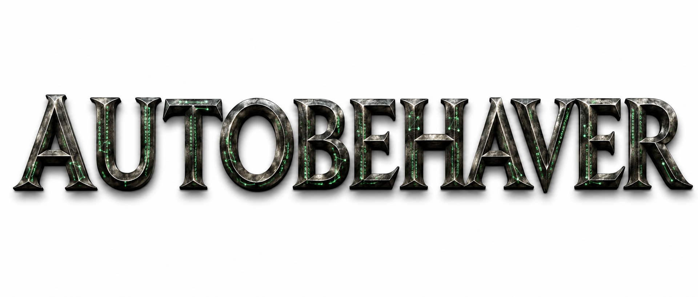

<p align="center">
  
</p>

# Autobehaver

Version **1.1.5**.

Autobehaver converts *Drosophila* recordings into behavior and orientation
predictions, per-animal feature matrices, and analyses of differences between
experimental groups. The pipeline includes
chamber cropping, DeepLabCut keypoint extraction, keypoint-derived features,
PosePred transformer inference, feature importance, PCA, feature set enrichment
analysis (FSEA), and annotated movies.

An agent can [prepare a named setup draft](docs/AGENT_SETUP.md) and open it in the
desktop launcher for review. Advanced controls expose inference, analysis and
training options while retaining the normal Build, Send and Submit workflow.

The accompanying preprint is [Autobehaver: An AI-Based Pipeline for Animal
Behavior Analysis](https://www.biorxiv.org/content/10.64898/2026.05.12.724596v1).

## Installation

Create the main scientific environment and register the source package:

```bash
git clone https://github.com/NHLBI/autobehaver.git
cd autobehaver
conda env create -f environment/environment.yml
conda activate autobehaver
python -m pip install -e ".[monitoring]"
python environment/check_environment.py --require-monitoring
python -m autobehaver --version
```

The main environment supports MovieChecker and every stage after keypoint
extraction. DeepLabCut uses a separate environment:

```bash
conda env create -f environment/environment-dlc-tf.yml
conda activate autobehaver-dlc
python -m pip install -e .
python environment/check_environment.py --dlc-only --require-dlc
python -m autobehaver.preinf.dlc --help
```

For an existing cluster module with an older Python, run Autobehaver in the main
environment and pass the module's launcher with `--dlc_python python-DLC`.
Only DeepLabCut's API calls run in that separate interpreter; it does not need
Autobehaver installed. The model, video, output and temporary paths must be
visible from both environments.
See [environment setup](environment/environment_README.md) for platform details.

Trained models and example recordings are supplied separately from Git. See
[model and normalization resources](docs/MODEL_DISTRIBUTION.md) before inference.

## Workflow

Run `python -m autobehaver` for the command-line roadmap. Each stage accepts
`--help`, explicit paths, and `--main_dir` for the numbered project layout.
Explicit input/output paths take priority over paths derived from `--main_dir`.
Progress automatically uses a live line in terminals and sparse messages in job
logs. See [progress reporting](docs/PROGRESS.md) for counts and display overrides.
Adapt the [command examples](examples/pipeline_commands.txt) to your project and
experimental group labels.

For Slurm-based HPC, [prepare the submission on your desktop](docs/HPC.md), then run its
lightweight submission command over SSH. Fast (default) prepares parallel batches;
Slow uses one full-dataset job per stage. Add `--publish-to` to copy and verify the
prepared jobs and current source package through a mounted HPC drive.
Fast preparation discovers usable recordings from `1_full_movies`, MovieChecker's
`exclusions.csv` and recording occupancy metadata. It generates the batch lists;
ordinary use does not require a user-written movie list or swarm file. One
submission schedules cropping through the final MMGen outputs and benchmark
collection. FeatureImp and annotated-movie rendering are separate optional steps.
Processing commands retry once after a failure before downstream jobs can be
cancelled. The same submission command with `--resume` restarts failed or
cancelled work; see [failure handling](docs/HPC.md#failures-and-restart).
Every processing stage uses the same dataset
root and writes directly into its standard numbered folders. Job files and logs stay
outside the dataset; submission does not create trial or combined-input workspaces.

| Step | Python module | Project input / output |
| --- | --- | --- |
| Review recordings | `autobehaver.preinf.moviechecker` | `1_full_movies`, including `exclusions.csv` |
| Crop chambers | `autobehaver.preinf.autocropper` | `1_full_movies` to `2_cropped_movies` |
| Extract keypoints | `autobehaver.preinf.dlc` | `2_cropped_movies` to `3_dlc` |
| Calculate features | `autobehaver.preinf.keypre` | `3_dlc` to `4_keypoint_features` |
| Normalize features | `autobehaver.preinf.keyprenorm` | `4_keypoint_features` to `5_normalized_features` |
| Predict behavior/orientation | `autobehaver.preinf.posepred_inference` | `5_normalized_features` to `6_posepred_inference` |
| Generate master matrices | `autobehaver.postinf.mmgen` | Features and predictions to `8_master_matrix` |
| Analyze group differences | `autobehaver.postinf.featureimp` | `8_master_matrix` to `9_feature_importance` |
| Render annotated movies | `autobehaver.postinf.infmovie` | Crops and predictions to `7_infmovies` |

For example:

```bash
python -m autobehaver.preinf.moviechecker --main_dir /path/to/project
python -m autobehaver.preinf.autocropper --main_dir /path/to/project
python -m autobehaver.postinf.featureimp --help
```

MovieChecker opens a review window and saves chamber exclusions. Both it and
Autocropper accept `--recording_database_csv` or `--recording_database_dir` for
session recording databases or per-chamber occupancy records. Recording
exclusions and manual exclusions both apply. Ordinary folder processing discovers
movies automatically; an explicit movie list is an optional subset selection.

The standard crop is 600 x 600 pixels, from 2016 x 1520 recordings or the supported
2028 x 1520 variant. The standard analysis timing is 40 frames per second.
The frozen PosePred ensemble uses the 16-, 32-, and 64-head epoch-301 checkpoints,
matching normalization parameters, a 41-frame window, and ten augmented inference
passes by default. Recordings may have different lengths. Source-frame identities
follow the data through preprocessing and inference; unavailable edge predictions
remain blank on the original movie timeline.

Augmented inference records `--tta_seed` (default 42). Noise draws follow the
recording, model, pass and original center frame, so changing file order or batch
size does not select different augmentations. Regeneration can differ from older
unseeded runs. Hardware and numerical-library differences can still affect model
roundoff; the seed does not promise identical results across every platform.

Every master matrix has **9,406 feature columns**, plus animal identifiers and
metadata. The catalog covers bout summaries, time budgets, body measurements,
posture, bout-based kinematics, transitions, sleep, spatial summaries and global speed.
Unavailable measurements remain NaN, distinct from a measured zero. FeatureImp
filters its analysis copy according to the selected completeness/variance criteria.
`MASTER_FEATURE_MATRIX_SCHEMA.json` records the full feature catalog.

MMGen pools each fly's observed frames and complete events across its recordings.
Recording boundaries remain separate: bouts, transitions, derivatives and
intervals never cross between files. Incomplete bouts at file edges or unknown
label gaps are excluded from bout-based measurements; their usable frames remain
available for ordinary frame-based features and time budgets. Walking start,
core and end features and duration-defined sleep still require complete bouts.
Internal missing-label gaps of at most four frames are filled only between
matching known labels (0.1 seconds at 40 fps); coordinates are never invented.
Each body measurement uses one reproducible sample of up to 100 frames per fly,
selected across recordings using the existing pose preference order. Wall-Side
stance area is excluded; Floor and Ceiling stance area remain available.

## Outputs, reruns and storage

Keep run manifests, validation receipts, checkpoints and `_names` maps with
results. These record resolved settings and input/model identities and allow
compact filenames to retain their complete original names. Existing outputs are
reused only after their stage-specific completion checks pass. See
[validation and integrity](docs/VALIDATION.md).

Use a short Windows project root such as `C:\ab`. For a checked, shallow export:

```powershell
python -m autobehaver.portable_export --source <results> --destination <empty-folder>
```

The export's `NAME_MAP.json` records original relative paths and hashes. It is a
transfer/archive representation; continue processing in the ordinary project tree
with its `_names` maps.

Temporary working arrays prefer `--scratch_dir`, `AUTOBEHAVER_SCRATCH_DIR`,
allocated cluster scratch, or the system temporary directory. Successful runs
remove owned working files; failed runs preserve them when the scratch location
permits. MMGen removes its temporary HDF store after successful complete
publication unless `--keep_temp_files` is selected. Interrupted or staged runs
retain the temporary store they require. Keep the same frozen package throughout
a staged or resumed run.

Shard recommendations count input files and can incorporate observed task times:

```bash
python -m autobehaver.shard_advice --input-dir <movies> --workers 4
```

Optional [runtime/resource monitoring](docs/resource_monitoring.md) records
elapsed time and available CPU/RAM/GPU measurements with `--resource-monitor`.
The maintained HPC templates enable it and collect scheduler accounting and
per-command timing alongside the stage reports.

## PosePred training

```bash
python -m autobehaver.training.posepred_training --help
```

Training requires normalized feature HDF5 files, human label files, and metadata
with `filename`, `labels`, and, for a predefined split, `set` columns containing
`train` or `val`. `--directory` selects the training folder; `--metadata_tag`
selects the metadata filename suffix. For `metadata.csv`, use
`--metadata_tag metadata`. The default suffix is
`fullcatvalsplitmetadata.csv`.

The default supervised architecture uses 41 frames, 1024 embedding dimensions,
4096 feed-forward dimensions, one encoder layer, 32 attention heads, sinusoidal
position encoding, the middle-frame representation, and MLP prediction heads.
Training uses batch size 1024, seed 7, learning rate 0.0001, and 301 epochs:
one warmup epoch followed by 300 cosine-decay epochs ending at 0.000001.
For shorter runs, change both `--num_epochs` and `--cosine_decay_epochs` so the
warmup and decay durations sum to the total. Set `--cosine_decay_epochs 0` to
use the step-based scheduler controls. SWA, pretraining and learning-rate sweeps
use their own step-based schedules.

Validation remains enabled by default. Use `--noval` for final full-data training.
The deployment ensemble requires three separate runs with `(nhead, random_seed)`
settings `(16, 7)`, `(32, 14)`, and `(64, 21)`, followed by inference using all three
final checkpoints. Existing saved settings and checkpoint resumes retain their
recorded configuration; new defaults do not rewrite those runs.

A full checkpoint resume requires unchanged feature and label contents.
`--restart_optimizer` explicitly loads weights with a fresh optimizer/scheduler
and permits refreshed input contents. Supervised restarts retain the saved
train/validation membership. Use a new run name to retain the earlier run's
records; see [training data contracts](docs/VALIDATION.md#data-contracts).

## Checks

In the scientific environment:

```bash
python -m pip install -e ".[dev]"
python -m pytest -q
```

See [validation and integrity](docs/VALIDATION.md) for completion checks,
compatibility requirements and release verification. Synthetic tests do not
establish runtime or memory requirements for a particular dataset.

The optional [Windows desktop launcher](docs/DESKTOP.md) provides Pipeline,
FeatureImp and PosePred training tabs with separate Build, Send and Submit actions,
scheduler monitoring and workflow-specific recovery. Training checkpoints and
records are written to a separate run folder.

## Citation and license

O'Neill, R.S., Aviles, S., and Rusan, N.M. **Autobehaver: An AI-Based Pipeline for
Animal Behavior Analysis.** bioRxiv, 2026.
doi: [10.64898/2026.05.12.724596](https://doi.org/10.64898/2026.05.12.724596).

Autobehaver is a U.S. Government Work prepared by NIH/NHLBI employees as part of
their official duties. See [LICENSE.txt](LICENSE.txt) and
[third-party notices](THIRD_PARTY_NOTICES.md).
